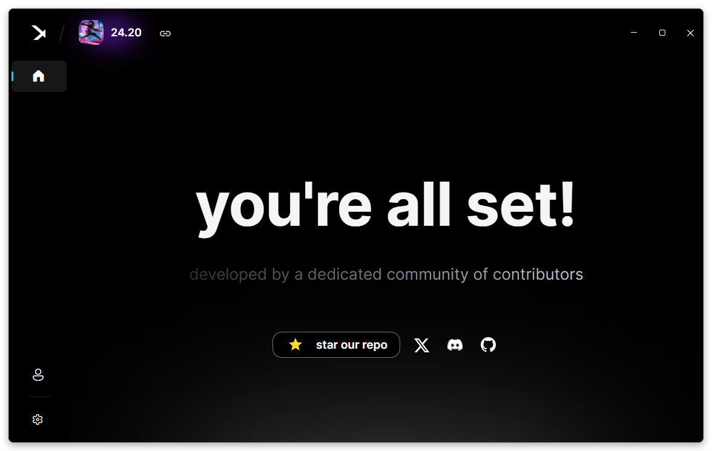
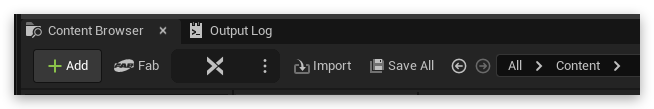
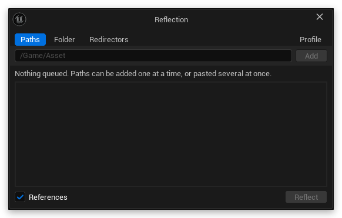

<br/>
<div align="center">
  <!--
  Also popularly known as "JAA", standing for Json As Asset.
  Now known as Reflection, can be used in a way like "Reflect that asset!"
  -->
  
  <a href="https://github.com/JsonAsAsset/Reflection">
    <p>
      
    </p>
  </a>
</div>

<div align="center">

Reflection is the standard for bringing game assets into Unreal Engine. Materials, meshes, data tables, physics assets and more, rebuilt in your project from a path copied out of [FModel](https://github.com/4sval/FModel).

[](https://www.youtube.com/watch?v=M28If8DOUXk)

[](/../../stargazers)
[](/../../releases)
[](https://discord.gg/xXEw4jc2UT)
[](https://github.com/JsonAsAsset/Reflection/blob/main/LICENSE)

</div>

<a href="#"></a>

**[Uses](#uses)** · **[Asset Types](#asset-types)** · **[Installation](#installation)** · **[Cloud](#cloud)** · **[Workflow](#workflow)** · **[Contributors](#contributors)**

<a name="uses"></a>
## Uses 🧩
<table>
  <tr>
    <td width="50%" valign="top"><b>Materials</b><br/>Materials, functions and instances, with data assets and data tables. <a href="#asset-types">See every type</a></td>
    <td width="50%" valign="top"><b>Meshes and physics</b><br/>Skeletal and static meshes, with the physics assets behind them.</td>
  </tr>
  <tr>
    <td width="50%" valign="top"><b>Sound</b><br/>Sound cues and most other sound classes, ready to play.</td>
    <td width="50%" valign="top"><b>Whole workflows</b><br/>Name one asset and everything it references comes with it.</td>
  </tr>
</table>

This project aims to streamline the porting and modding experience, making it easier to bring game assets into Unreal Engine.

<a name="asset-types"></a>
## Asset Types 📦
Anything not listed here isn't supported yet.

| Category | Types |
|:--|:--|
| 🟠 **Material** | Material, MaterialFunction, MaterialInstanceConstant, MaterialParameterCollection, SubsurfaceProfile |
| 🟧 **Texture** | Texture2D, TextureCube, Texture2DArray, VolumeTexture, TextureRenderTarget2D, TextureLightProfile, RuntimeVirtualTexture, PaperSprite, PaperSpriteAtlas |
| 🟦 **Mesh** | SkeletalMesh, StaticMesh |
| ⚪ **Physics** | PhysicsAsset, PhysicalMaterial |
| 🔴 **Animation** | AnimSequence, AnimMontage, PoseAsset, Skeleton, SkeletalMeshLODSettings, BlendSpace, BlendSpace1D, AimOffsetBlendSpace, AimOffsetBlendSpace1D, ControlRigBlueprintGeneratedClass |
| 🟡 **Sound** | SoundCue and most other sound classes |
| 🟢 **Curve** | CurveFloat, CurveVector, CurveLinearColor, CurveLinearColorAtlas |
| 🔵 **Table** | CurveTable, DataTable, MirrorDataTable, StringTable |
| 🟣 **Data** | DataAsset, CurveExpressionsDataAsset, SlateBrushAsset, SlateWidgetStyleAsset, LandscapeLayerInfoObject, HLODProxy, AnimBoneCompressionSettings, AnimCurveCompressionSettings, FortBakedPropertyMetadataCache, UserDefinedEnum, UserDefinedStruct |
| ✨ **Effects** | ParticleSystem, VectorFieldStatic |
| 💫 **Niagara** | NiagaraParameterCollection, NiagaraParameterCollectionInstance, NiagaraParameterDefinitions, NiagaraEffectType, NiagaraDataChannelAsset, NiagaraAssetTagDefinitions, NiagaraValidationRuleSet, NiagaraSimCache, NiagaraSystemReadinessSettings |
| 🟩 **Landscape** | LandscapeGrassType, FoliageType_InstancedStaticMesh, FoliageType_Actor |
| 🟤 **Sequencer** | CameraAnim, ForceFeedbackEffect |
| 🧠 **AI** | BehaviorTree, BlackboardData |
| 🔤 **UI** | Font, FontFace |

### Blueprints and Levels
> [!WARNING]
> **Experimental.** Both need **Enable Experiments** in Plugin Settings.

Blueprints, Widget Blueprints and Animation Blueprints rebuild their components, variables and defaults, and their graphs are rebuilt from the bytecode where the parent class exists. Levels place the actors they hold, with settings for what to place and what to skip.

<a name="material-data-prerequisites"></a>
> [!NOTE]
> **Material data.** Unreal Engine games made below 4.12 (a guess) will have material data. *Games made above that version will most definitely not have any material data*, and therefore the actual data will be stripped and cannot be imported. **Unless you are using a User Generated Content editor**, then it's possible material data will be there.

> [!TIP]
> **C++ classes.** If your game uses custom C++ classes or structures, **you need to define them**. See [Unreal Engine Modding Projects](https://github.com/Buckminsterfullerene02/UE-Modding-Tools?tab=readme-ov-file#game-specific-template-projects) for game-specific template projects.

<a name="installation"></a>
## Installation ⚙️
> [!IMPORTANT]
> Install [FModel](https://fmodel.app) and set it up before going any further.

1. **Add the plugin to your project.** From your project root, where the `.uproject` is:

   ```sh
   git submodule add https://github.com/JsonAsAsset/Reflection.git Plugins/Reflection
   git submodule update --init --recursive
   ```

   This tracks every commit, so fixes for new Unreal versions reach you first, though it may occasionally need a manual fix. For a stable release instead, download **Source code (zip)** from the [Releases page](/../../releases) and extract it to `Project/Plugins/Reflection/`.

2. **Build it** for your engine version, following [Epic's guide](https://dev.epicgames.com/community/learning/tutorials/qz93/unreal-engine-building-plugins).

3. **Open your project.** The Reflection button appears on the content browser toolbar.

<details>
  <summary>Build failing on <b>Unreal Engine 4</b> with <b>UnrealBuildTool.exe</b> not found?</summary>
  <br>

Some UE4 builds are missing a platform path. Add this to the bottom of `UE_[VERSION]/Engine/Config/BaseEngine.ini` and save:

```ini
[PlatformPaths]
UnrealBuildTool=Engine/Binaries/DotNet/UnrealBuildTool.exe
```
</details>

<a name="cloud"></a>
## Cloud ☁️
The Cloud app is **Mirror**. It reads the game's files and hands Reflection each asset as it's asked for, over `localhost:1500`. [Set up an instance](https://github.com/JsonAsAsset/Mirror/releases) and start it.



With Mirror running, Reflection:
- **Fetches references automatically** instead of asking you for each one.
- **Pulls data a json export doesn't carry**, like mesh geometry, skin weights and morph targets.
- **Reads from the profile you pick**, one per game build, from the **Profile** tab of the Reflection dialog.

> [!TIP]
> No Cloud? Turn on **Use Local Json instead of Cloud** in Plugin Settings, and the Reflection button imports a json you exported from FModel yourself. References aren't fetched for you that way.

<a name="workflow"></a>
## Workflow 🔁
Reflection works off **asset paths**. With [Cloud](#cloud) running, nothing has to be saved out of FModel first.

1. **Copy an asset's path** in FModel, like `/Game/Asset.uasset`. A reference copied straight out of FModel works too.

2. **Press the Reflection button** on the content browser toolbar. Paths already on your clipboard are queued for you.

   

3. **Queue as many as you want.** Type or paste a path and press `Enter`. Several pasted at once queue one per line, and `X` takes one back out.

   

4. **Press Reflect.** Every reference each asset needs is fetched as it goes, so you only ever name the one you want.

Anything that couldn't be rebuilt is listed in the **Errors** window at the end.

> [!CAUTION]
> Please note that this plugin is intended solely for **personal and educational use**.
> 
> Do not use it to create or distribute **commercial products** without obtaining the necessary **licenses and permissions**. It is important to respect **intellectual property rights** and only use assets that you are **authorized to use**.
>
> We **do not assume any responsibility** for the way the created content is used.

<a name="contributors"></a>
## Contributors ❤️

Thanks go to these wonderful people:

<!-- prettier-ignore-start -->
<!-- markdownlint-disable -->
<table>
  <tr>
    <td align="center"><a href="https://github.com/Tectfy"><br/><sub><b>Tector</b></sub></a><br/>Creator</td>
    <td align="center"><a href="https://github.com/GMatrixGames"><br/><sub><b>GMatrixGames</b></sub></a><br/>Co-Founder</td>
  </tr>
</table>

<a href="https://github.com/JsonAsAsset/Reflection/graphs/contributors">
  
</a>

Thanks to the people who contributed to [UEAssetToolkit](https://github.com/Buckminsterfullerene02/UEAssetToolkit-Fixes)!
